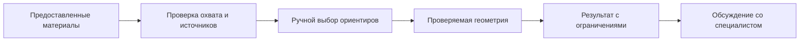

# mri-review

**Как сделать исследовательский разбор МРТ проверяемым — от исходного кадра до числа в отчёте.**

Экспериментальный навык для ИИ-ассистента: помогает организовать материалы, выбрать анатомический профиль, отделить наблюдения от интерпретаций и сохранить происхождение измерений. Небольшой Python-калькулятор переводит вручную заданные точки из сетки изображения в физические координаты.

English: an experimental, source-traceable MRI research workflow with a standard-library geometry calculator for manually supplied landmarks. No patient data, trained models, or DICOM reader are included.

## Назначение

В основе проекта простой вопрос: **можно ли проверить, откуда взялось утверждение или измерение?** Поэтому каждый шаг связывается с источником, выбранной геометрией и ограничениями. Инструкции загружаются по задаче: пояснение заключения, разбор изображений, сравнение исследований, измерение.

Это исследовательский прототип без клинической валидации. Он не является автономной системой диагностики, сортировки пациентов или назначения лечения. Наблюдения ИИ требуют проверки квалифицированным специалистом. Упоминание DICOM и профессиональных рекомендаций не означает сертификацию или подтверждённую диагностическую точность.



## Работа с проектом

Для калькулятора достаточно Python 3.10+; сторонних зависимостей и сетевых запросов нет. Из корня репозитория:

```sh
python3 scripts/measure_landmarks.py references/synthetic-landmarks.json
python3 -m unittest discover -s tests -v
```

В искусственном примере ожидаются **3 мм** до прямой, **5 мм** длины и **4 мм** проекции (знак вдоль заданной оси: **−4 мм**). Подробности формата и соглашения о координатах — в [измерениях](references/measurements.md).

Параметр `--output` создаёт новый файл и отказывается заменять существующий. Для публикации полностью записанного результата файловая система должна поддерживать жёсткие ссылки; иначе команда завершится ошибкой. Для просмотра без записи этот параметр не нужен.

Поддерживаются `length`, `perpendicular` до бесконечной прямой и `patient_axis_projection`. Калькулятор не читает DICOM, не находит анатомию и не проверяет происхождение переданных метаданных. Для точек из разных кадров нужен другой расчёт.

Для использования как навыка поместите этот каталог в каталог пользовательских навыков вашего совместимого агента под именем `mri-review`. Начните с [SKILL.md](SKILL.md). В среде с поддержкой `$skill-name` навык вызывается как `$mri-review`. Сам по себе навык не устанавливает просмотрщик, модели или медицинское ПО.

**Приватность:** в репозитории только синтетический пример. Калькулятор сохраняет весь `input_record` в результате и не обезличивает его. Настоящие исследования, разметку и результаты храните вне репозитория. Локальная работа скрипта не означает локальность ИИ-ассистента: перед использованием материалов отдельно проверьте, куда выбранный агент передаёт данные. Подробнее — [SECURITY.md](SECURITY.md).

## Карта материалов

| Материал | Содержание |
|---|---|
| [SKILL.md](SKILL.md) | Вход в навык и выбор режима |
| [Профили](references/anatomy-profiles.md) / [процесс](references/workflow.md) | Охват, источники, сравнение и границы выводов |
| [Измерения](references/measurements.md) | Геометрия, формат данных и ограничения |
| [Специальные методики](references/specialized-mri.md) | Когда одного линейного расчёта недостаточно |
| [Отчёт и обсуждение](references/reporting-and-followup.md) | Как сохранять неопределённость и связь с источником |
| [Код](scripts/measure_landmarks.py) / [тесты](tests/) | Проверяемая арифметика на искусственных данных |

Авторский код и текст — [MIT](LICENSE). Связанные стандарты, статьи и рекомендации сохраняют права своих владельцев; их копии здесь не распространяются. См. [THIRD_PARTY_NOTICES.md](THIRD_PARTY_NOTICES.md).
